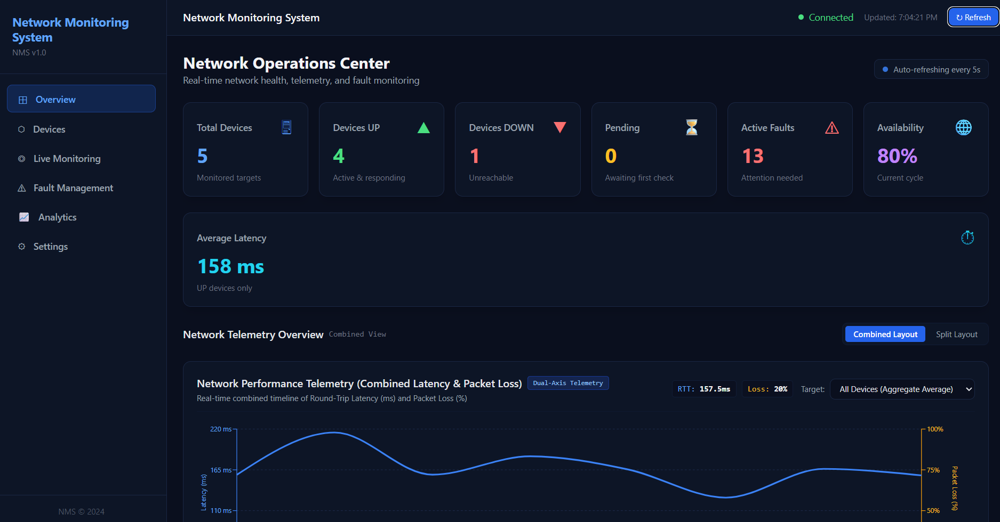
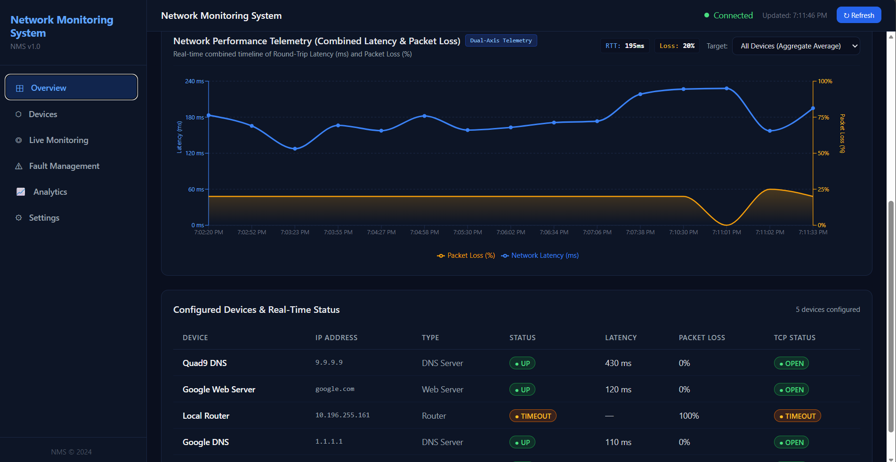
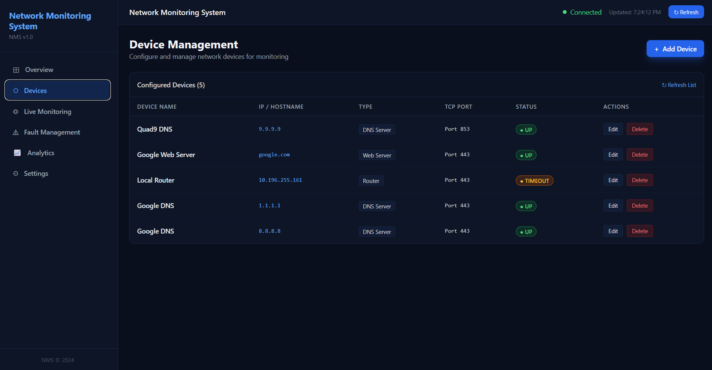
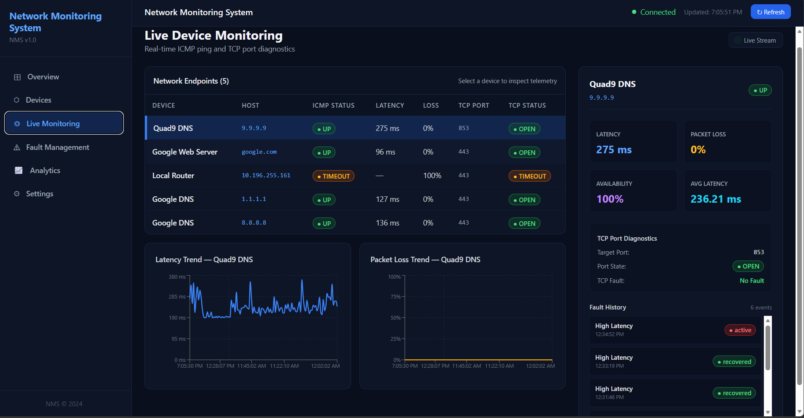
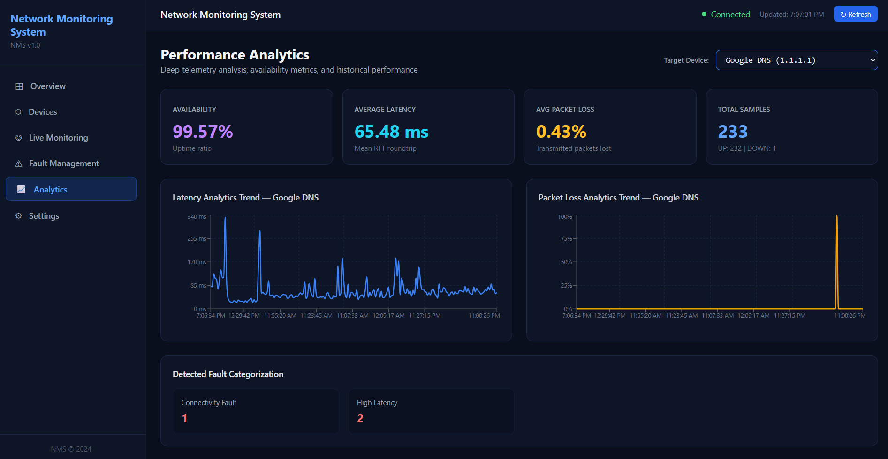

# Network Monitoring System (NMS)

A real-time **Network Monitoring System** built using Python, React, Node.js, Express, and MongoDB. It monitors network devices, tracks connectivity, measures latency and packet loss, checks TCP port availability, and detects network faults through an interactive monitoring dashboard.

---

## Overview

The Network Monitoring System (NMS) is designed to monitor network device health and analyze network performance in real time.

It combines a Python-based monitoring engine with a Node.js backend and a React dashboard. Device information is stored in MongoDB, allowing users to dynamically manage monitored devices without manually modifying configuration files.

The system helps identify connectivity issues, high latency, packet loss, TCP port failures, and device recovery events.

## Key Features

- **Real-Time Network Monitoring:** Continuously monitors network devices using automated checks.
- **ICMP Ping Monitoring:** Checks device reachability, response time, and packet loss.
- **TCP Port Monitoring:** Checks whether specific TCP ports and services are accessible.
- **Fault Detection:** Identifies connectivity faults, timeout faults, high latency, and packet loss.
- **Dynamic Device Management:** Add, edit, and delete devices through the dashboard.
- **Automatic Device Discovery:** Python monitoring engine dynamically retrieves registered devices from the backend.
- **Fault Recovery Tracking:** Tracks when previously detected network faults are resolved.
- **Network Performance Analytics:** Visualizes latency and packet loss through interactive charts.
- **Combined and Split Chart Views:** Supports combined telemetry visualization and separate metric charts.
- **Dashboard Statistics:** Displays total devices and their current monitoring status.
- **Historical Monitoring:** Stores monitoring records for performance analysis.

## Technology Stack

| Component | Technologies |
|---|---|
| Frontend | React, Vite |
| Backend | Node.js, Express.js |
| Database | MongoDB, Mongoose |
| Monitoring Engine | Python 3.11 |
| Network Monitoring | ICMP Ping, TCP Socket |
| Data Visualization | Recharts |
| Version Control | Git, GitHub |

## System Architecture

```text
             NETWORK DEVICES
                    |
                    v
          PYTHON MONITORING ENGINE
                    |
          +---------+---------+
          |                   |
          v                   v
      ICMP PING           TCP CHECK
          |                   |
          +---------+---------+
                    |
                    v
             FAULT DETECTION
                    |
                    v
                REPORTER
                    |
                    v
             EXPRESS BACKEND
                    |
                    v
                 MONGODB
                    |
          +---------+---------+
          |                   |
          v                   v
      MONITORING API      ANALYTICS API
          |                   |
          +---------+---------+
                    |
                    v
              REACT DASHBOARD
                    |
                    v
           REAL-TIME VISUALIZATION
```

## Project Structure

```text
NMS/
│
├── backend/
│   ├── controllers/
│   ├── models/
│   ├── routes/
│   ├── server.js
│   └── package.json
│
├── frontend/
│   ├── src/
│   ├── public/
│   └── package.json
│
├── monitor/
│   ├── ping_monitor.py
│   ├── history.py
│   ├── reporter.py
│   ├── reporter_config.py
│   └── venv/
│
├── config/
│   ├── devices.json
│   └── settings.json
│
├── data/
│   └── monitoring_history.jsonl
│
├── start_nms.bat
├── stop_nms.bat
└── README.md
```

*Note: This represents the main project components. Additional files and directories may exist.*

## Installation and Setup

### 1. Prerequisites

Install the following:

- Python 3.11
- Node.js and npm
- MongoDB Community Server
- Git

### 2. Clone the Repository

```bash
git clone https://github.com/Ankit-git04/Network-Monitoring-System.git
cd Network-Monitoring-System
```

### 3. Configure MongoDB

Ensure MongoDB is installed and running.

For a local Windows MongoDB installation:

```powershell
mkdir data\db -Force
& "C:\Program Files\MongoDB\Server\7.0\bin\mongod.exe" --dbpath "data\db" --port 27017
```

Adjust the MongoDB installation path if necessary.

### 4. Start the Backend

Open a new terminal:

```bash
cd backend
npm install
npm run dev
```

The backend currently uses port 5000.

### 5. Start the Frontend

Open another terminal:

```bash
cd frontend
npm install
npm run dev
```

Open the dashboard:

http://localhost:5173

### 6. Set Up the Python Monitoring Engine

Open another terminal from the project root.

Create a virtual environment:

```bash
python -m venv monitor/venv
```

Activate it on Windows:

```powershell
.\monitor\venv\Scripts\Activate.ps1
```

Install any required external Python dependencies used by the project.

Start the monitoring engine:

```bash
python -u -m monitor.ping_monitor
```

Ensure MongoDB and the backend are running before starting the Python monitoring engine.

**Configuration:** Configure the backend API settings using the project's existing environment configuration. The Python reporter supports the `NMS_BACKEND_URL` environment variable.

## Running the Application

The application requires four services:

1. **MongoDB:** Stores device and monitoring information.
2. **Node.js Backend:** Provides APIs and database operations.
3. **React Frontend:** Displays the monitoring dashboard.
4. **Python Monitoring Engine:** Performs network checks and reports results.

Once all services are running, open:

http://localhost:5173


## 📸 Project Screenshots

### 1. Main Dashboard


### 2. Dashboard Overview


### 3. Device Management


### 4. Live Network Monitoring


### 5. Performance Analysis



## Monitoring Capabilities

### 1. Device Connectivity Monitoring

Uses ICMP ping to determine whether a network device is reachable.

Monitored parameters include:

- Device status
- Response time
- Packets sent and received
- Packet loss percentage

### 2. TCP Port Monitoring

Uses TCP socket connections to check service availability on configured ports.

Possible results:

- OPEN
- CLOSED
- TIMEOUT
- UNREACHABLE

A closed TCP port indicates that the specific service is unavailable. It does not automatically mean that the entire device is down.

### 3. Fault Detection

The system identifies different network conditions:

- Connectivity Fault
- Timeout Fault
- High Packet Loss
- High Latency
- TCP Port Fault
- No Fault

### 4. Network Analytics

The dashboard provides visual insights into network performance through:

- Network latency charts
- Packet loss charts
- Combined telemetry visualization
- Split chart visualization
- Device-specific monitoring
- Historical monitoring records

## Future Enhancements

- Email and SMS notification integration.
- Advanced network topology visualization.
- SNMP-based monitoring.
- Network traffic analysis.
- Predictive fault detection using machine learning.
- Role-based authentication and access control.
- Advanced reporting and export functionality.

## Learning Outcomes

Through this project, I explored:

- Practical computer networking concepts.
- ICMP and TCP-based network monitoring.
- Python socket programming and automation.
- REST API development and integration.
- MongoDB database management.
- Real-time frontend and backend communication.
- Network fault detection and troubleshooting.
- Building an end-to-end monitoring application.

## Author

**Ankit**

GitHub: [Ankit-git04](https://github.com/Ankit-git04)

Project Repository: [Network-Monitoring-System](https://github.com/Ankit-git04/Network-Monitoring-System)

---

*Built as a hands-on project to explore network engineering, monitoring automation, and full-stack application development.*